# Informe: Segundo Examen Parcial — Trabajando en la Nube (COM610)

**Universidad San Francisco Xavier de Chuquisaca**  
**Facultad de Tecnologia — Carrera de Ingenieria de Sistemas**  
**Docente:** Ing. Marcelo Quispe Ortega  
**Estudiante:** Jesus Adrian Ovando  
**Semestre:** 2/2026  
**Repositorio publico:** https://github.com/adrianOvando/Segundo_Parcial  
**URL publica de la API:** http://18.213.236.16  

---

## Ejercicio 1 — API REST en EC2 con base de datos RDS (50 puntos)

### 1.1 Infraestructura AWS

#### Instancia EC2

Se lanzo una instancia EC2 con las siguientes especificaciones:

| Parametro | Valor |
|---|---|
| Nombre | SegundoParcial |
| AMI | Ubuntu Server 26.04 LTS |
| Tipo de instancia | t3.micro |
| Region / Zona | us-east-1 / us-east-1c |
| IP Publica | 18.213.236.16 |
| VPC | vpc-032109f9980f630a4 |
| Par de claves | segundoparcial |

#### Instancia RDS

Se creo una instancia RDS con las siguientes especificaciones:

| Parametro | Valor |
|---|---|
| Identificador | rds-jao-libros |
| Motor | MySQL 8.4 |
| Clase | db.t4g.micro |
| Region / Zona | us-east-1 / us-east-1b |
| Endpoint | rds-jao-libros.cux88kege1o5.us-east-1.rds.amazonaws.com |
| Puerto | 3306 |
| Base de datos | libros_db |
| Acceso publico | No (solo desde la VPC) |

#### Grupos de Seguridad

Se configuraron dos grupos de seguridad dentro de la misma VPC:

**ec2-jao** (para la instancia EC2):

| Tipo | Protocolo | Puerto | Origen | Proposito |
|---|---|---|---|---|
| SSH | TCP | 22 | IP del estudiante | Administracion remota |
| HTTP | TCP | 80 | 0.0.0.0/0 | Acceso publico a la API |

**rds-jao** (para la instancia RDS):

| Tipo | Protocolo | Puerto | Origen | Proposito |
|---|---|---|---|---|
| MySQL/Aurora | TCP | 3306 | sg-ec2-jao | Solo desde EC2 |

**Captura — Reglas de entrada del grupo de seguridad EC2 (ec2-jao):**

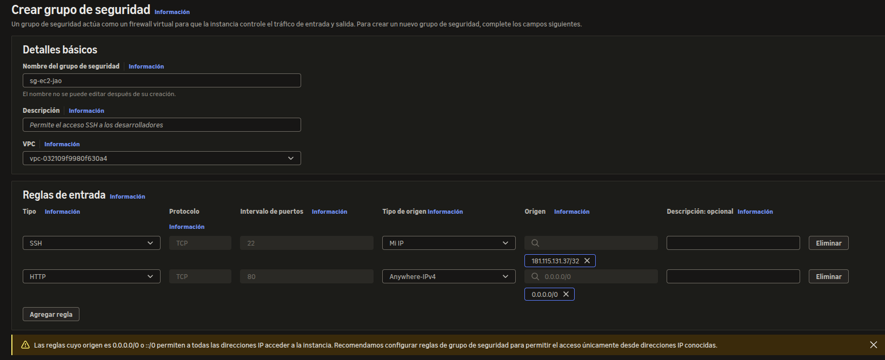

**Captura — Lista de grupos de seguridad creados:**

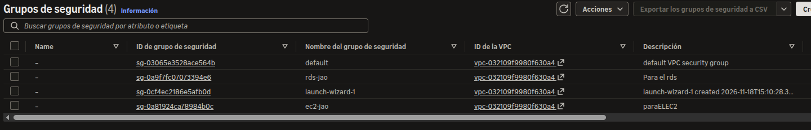

**Captura — Configuracion de lanzamiento: AMI Ubuntu y tipo t3.micro:**

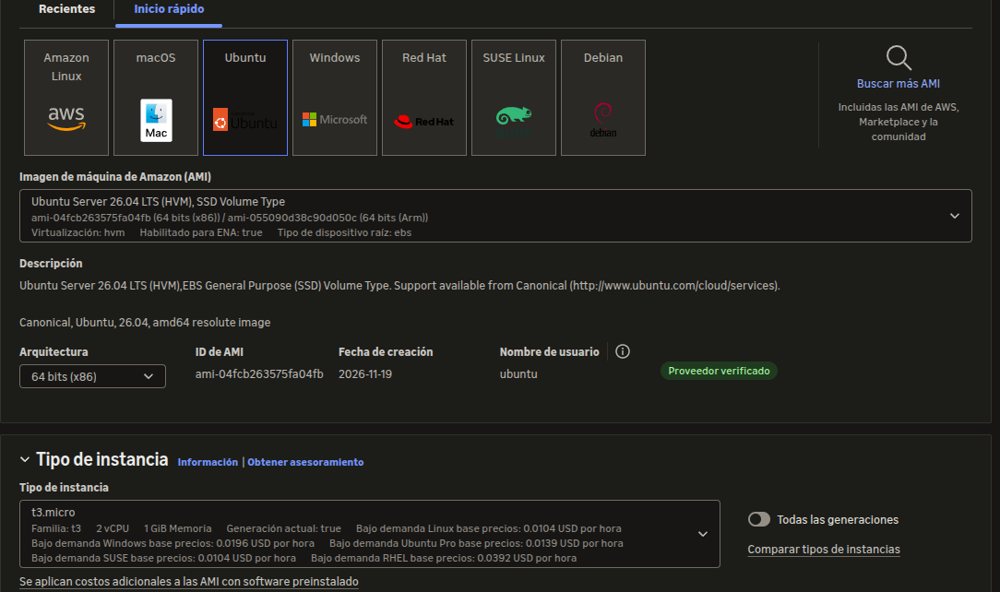

**Captura — Configuracion de lanzamiento: par de claves, VPC y SG:**

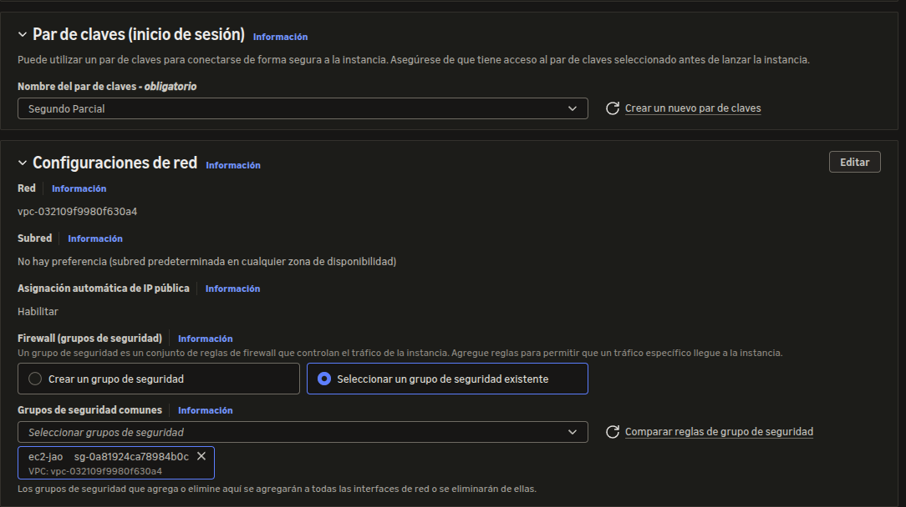

**Captura — Instancia EC2 en estado Running con IP 18.213.236.16:**

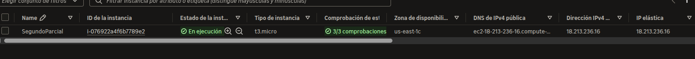

**Captura — Instancia RDS rds-jao-libros en estado Available:**

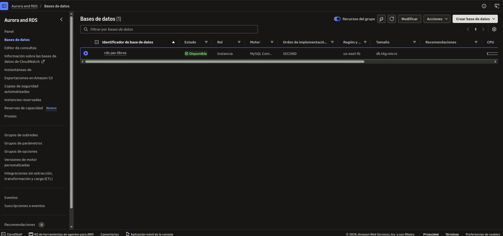

---

### 1.2 Conexion SSH y Preparacion del Servidor

Se conecto a la instancia EC2 mediante SSH utilizando el archivo de clave `.pem`:

```bash
ssh -i ~/Downloads/segundoparcial.pem ubuntu@18.213.236.16
```

Se instalo Node.js v20, Nginx y el cliente MySQL en la instancia:

```bash
curl -fsSL https://deb.nodesource.com/setup_20.x | sudo -E bash -
sudo apt install -y nodejs nginx mysql-client
```

**Captura — Conexion SSH exitosa a la instancia EC2:**

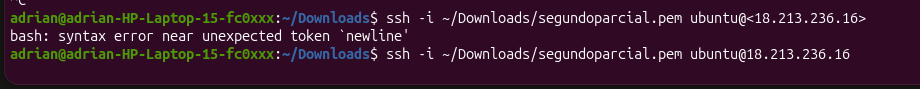

**Captura — Versiones instaladas de Node.js, Nginx y MySQL Client:**

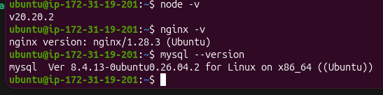

**Captura — Clonacion del repositorio en la instancia:**

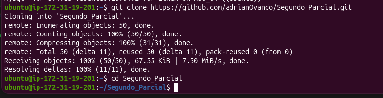

---

### 1.3 Modelo de Datos y Conexion a RDS

#### Script de base de datos (`db.sql`)

```sql
CREATE DATABASE IF NOT EXISTS libros_db
  CHARACTER SET utf8mb4
  COLLATE utf8mb4_unicode_ci;

USE libros_db;

CREATE TABLE IF NOT EXISTS libros (
  id INT AUTO_INCREMENT PRIMARY KEY,
  titulo VARCHAR(255) NOT NULL,
  autor VARCHAR(255) NOT NULL,
  anio_publicacion INT NOT NULL,
  created_at TIMESTAMP DEFAULT CURRENT_TIMESTAMP,
  updated_at TIMESTAMP DEFAULT CURRENT_TIMESTAMP ON UPDATE CURRENT_TIMESTAMP
) ENGINE=InnoDB DEFAULT CHARSET=utf8mb4 COLLATE=utf8mb4_unicode_ci;

INSERT INTO libros (titulo, autor, anio_publicacion) VALUES
('Cien anos de soledad', 'Gabriel Garcia Marquez', 1967),
('Don Quijote de la Mancha', 'Miguel de Cervantes', 1605),
('Ficciones', 'Jorge Luis Borges', 1944),
('Rayuela', 'Julio Cortazar', 1963),
('El amor en los tiempos del colera', 'Gabriel Garcia Marquez', 1985);
```

**Captura — Estructura de la tabla `libros` y datos en RDS:**

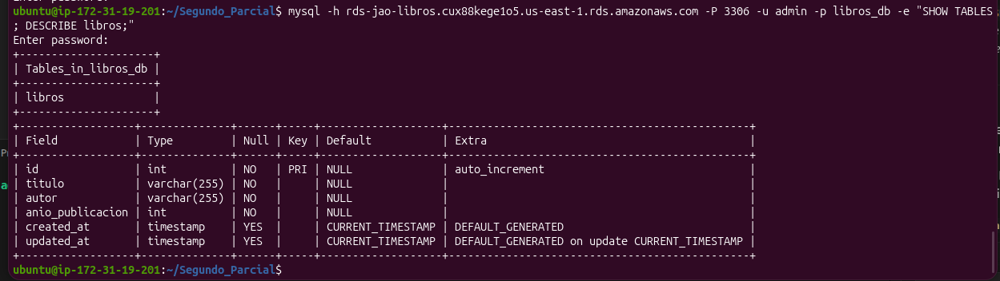

#### Modulo de conexion (`src/config/db.js`)

```javascript
const mysql = require('mysql2/promise');
require('dotenv').config();

const pool = mysql.createPool({
  host: process.env.DB_HOST || 'localhost',
  port: parseInt(process.env.DB_PORT || '3306', 10),
  user: process.env.DB_USER || 'admin',
  password: process.env.DB_PASSWORD || '',
  database: process.env.DB_NAME || 'libros_db',
  waitForConnections: true,
  connectionLimit: 10,
  queueLimit: 0
});

module.exports = pool;
```

#### Variables de entorno (`.env.example`)

```
PORT=3000
DB_HOST=rds-libros-db.c9822oewk9c2.us-east-1.rds.amazonaws.com
DB_PORT=3306
DB_USER=admin
DB_PASSWORD=TuPasswordSeguro123!
DB_NAME=libros_db
NODE_ENV=production
```

> El archivo `.env` real con credenciales reales no se sube al repositorio. Queda almacenado en `/home/ubuntu/.env` dentro de la instancia EC2.

---

### 1.4 Implementacion de la API REST

La API sigue el patron MVC con Express.js. La estructura del proyecto es:

```
src/
  app.js              — Express, middlewares, rutas (exportado sin listen)
  server.js           — Importa app y llama app.listen(3000)
  config/db.js        — Pool de conexiones MySQL2
  controllers/
    libroController.js — Logica de negocio y validacion
  models/
    libroModel.js      — Consultas SQL parametrizadas
  routes/
    libroRoutes.js     — Definicion de endpoints
```

#### Endpoints disponibles

| Metodo | Ruta | Descripcion | Respuesta exitosa |
|---|---|---|---|
| GET | /health | Estado de la API | 200 OK |
| GET | /libros | Listar todos los libros | 200 OK + JSON array |
| GET | /libros/:id | Obtener un libro por ID | 200 OK + JSON objeto |
| POST | /libros | Crear un nuevo libro | 201 Created + JSON |
| PUT | /libros/:id | Actualizar un libro | 200 OK + JSON |
| DELETE | /libros/:id | Eliminar un libro | 200 OK + mensaje |

#### Validaciones implementadas

- `titulo` y `autor` son obligatorios y no pueden estar vacios.
- `anio_publicacion` debe ser un numero entero valido.
- Si falla la validacion, la API retorna `400 Bad Request` con detalle del error.
- Si el libro no existe, retorna `404 Not Found`.
- Todas las consultas usan parametros preparados (prevencion de SQL injection).

---

### 1.5 Puesta en Marcha con PM2

```bash
cd /home/ubuntu/Segundo_Parcial/ejercicio1
cp .env.example .env
# (editar .env con las credenciales reales de RDS)
npm install
pm2 start src/server.js --name libros-api
pm2 save
pm2 startup
```

**Captura — `npm install` y `pm2 start` exitosos:**

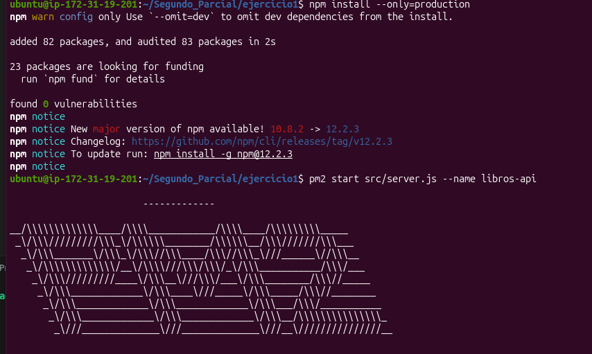

---

### 1.6 Nginx como Proxy Inverso

Se configuro Nginx para recibir trafico en el puerto 80 y redirigirlo al servidor Node.js en `127.0.0.1:3000`. El puerto 3000 no queda expuesto directamente a Internet.

#### Configuracion de Nginx (`nginx.conf`)

```nginx
server {
    listen 80 default_server;
    listen [::]:80 default_server;
    server_name _;

    access_log /var/log/nginx/libros_api_access.log;
    error_log /var/log/nginx/libros_api_error.log;

    location / {
        proxy_pass http://127.0.0.1:3000;
        proxy_http_version 1.1;
        proxy_set_header Upgrade $http_upgrade;
        proxy_set_header Connection 'upgrade';
        proxy_set_header Host $host;
        proxy_set_header X-Real-IP $remote_addr;
        proxy_set_header X-Forwarded-For $proxy_add_x_forwarded_for;
        proxy_set_header X-Forwarded-Proto $scheme;
        proxy_cache_bypass $http_upgrade;
    }
}
```

**Captura — `nginx -t` OK y `systemctl restart nginx` exitoso:**

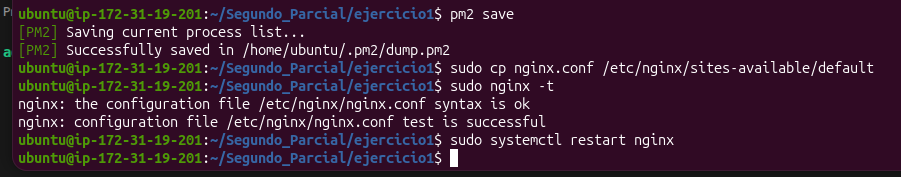

---

### 1.7 Verificacion de la API con curl

Se ejecutaron los siguientes comandos curl para verificar el correcto funcionamiento de todos los endpoints desde la maquina local.

#### GET /health — Estado de la API

```bash
curl -i http://18.213.236.16/health
```

```
HTTP/1.1 200 OK
Server: nginx/1.28.3 (Ubuntu)
Content-Type: application/json; charset=utf-8
Content-Length: 131

{"status":"ok","service":"API Catálogo de Libros","version":"1.1.0","uptime":551.504722487,"timestamp":"2026-11-20T02:01:00.121Z"}
```

**Captura — `curl localhost:3000/health` desde la instancia EC2:**

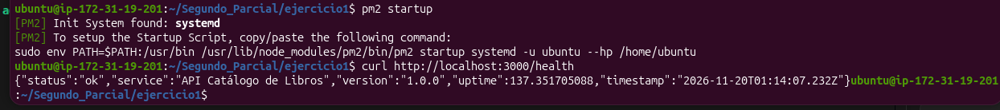

**Captura — Respuesta de `/health` en el navegador (IP publica):**

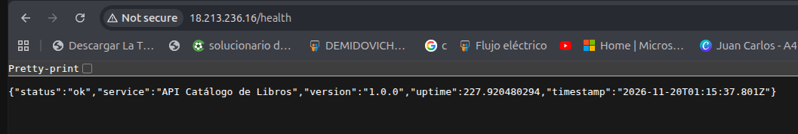

---

#### GET /libros — Listar todos los libros

```bash
curl -i http://18.213.236.16/libros
```

```
HTTP/1.1 200 OK
Server: nginx/1.28.3 (Ubuntu)
Content-Type: application/json; charset=utf-8
Content-Length: 1569

[{"id":2,"titulo":"Don Quijote de la Mancha","autor":"Miguel de Cervantes","anio_publicacion":1605,...},
 {"id":3,"titulo":"Ficciones","autor":"Jorge Luis Borges","anio_publicacion":1944,...},
 {"id":4,"titulo":"Rayuela","autor":"Julio Cortázar","anio_publicacion":1963,...},
 {"id":5,"titulo":"El amor en los tiempos del cólera","autor":"Gabriel García Márquez","anio_publicacion":1985,...},
 {"id":6,"titulo":"Cien años de soledad","autor":"Gabriel García Márquez","anio_publicacion":1967,...}]
```

**Captura — Listado de libros en el navegador:**

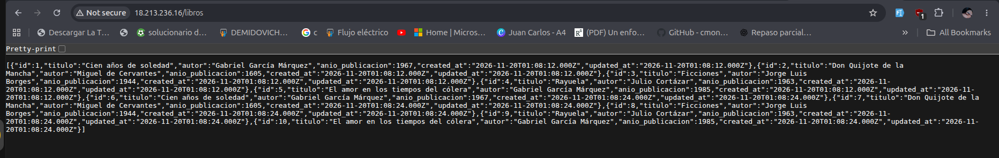

---

#### POST /libros — Crear libro valido (201 Created)

```bash
curl -i -X POST http://18.213.236.16/libros \
  -H "Content-Type: application/json" \
  -d '{"titulo":"El Aleph","autor":"Jorge Luis Borges","anio_publicacion":1949}'
```

```
HTTP/1.1 201 Created
Server: nginx/1.28.3 (Ubuntu)
Content-Type: application/json; charset=utf-8
Content-Length: 81

{"id":11,"titulo":"El Aleph","autor":"Jorge Luis Borges","anio_publicacion":1949}
```

---

#### GET /libros/:id — Obtener libro por ID (200 OK)

```bash
curl -i http://18.213.236.16/libros/2
```

```
HTTP/1.1 200 OK
Server: nginx/1.28.3 (Ubuntu)
Content-Type: application/json; charset=utf-8
Content-Length: 178

{"id":2,"titulo":"Don Quijote de la Mancha","autor":"Miguel de Cervantes","anio_publicacion":1605,"created_at":"2026-11-20T01:08:12.000Z","updated_at":"2026-11-20T01:08:12.000Z"}
```

---

#### GET /libros/:id — ID inexistente (404 Not Found)

```bash
curl -i http://18.213.236.16/libros/9999
```

```
HTTP/1.1 404 Not Found
Server: nginx/1.28.3 (Ubuntu)
Content-Type: application/json; charset=utf-8
Content-Length: 43

{"error":"Libro con ID 9999 no encontrado"}
```

---

#### PUT /libros/:id — Actualizar libro (200 OK)

```bash
curl -i -X PUT http://18.213.236.16/libros/2 \
  -H "Content-Type: application/json" \
  -d '{"titulo":"Don Quijote de la Mancha (Edicion Clasica)","autor":"Miguel de Cervantes","anio_publicacion":1605}'
```

```
HTTP/1.1 200 OK
Server: nginx/1.28.3 (Ubuntu)
Content-Type: application/json; charset=utf-8
Content-Length: 116

{"id":2,"titulo":"Don Quijote de la Mancha (Edicion Clasica)","autor":"Miguel de Cervantes","anio_publicacion":1605}
```

---

#### POST /libros — Datos invalidos (400 Bad Request)

```bash
curl -i -X POST http://18.213.236.16/libros \
  -H "Content-Type: application/json" \
  -d '{"titulo":"","autor":"Desconocido","anio_publicacion":"dos mil"}'
```

```
HTTP/1.1 400 Bad Request
Server: nginx/1.28.3 (Ubuntu)
Content-Type: application/json; charset=utf-8
Content-Length: 176

{"error":"Datos de entrada inválidos","detalles":["El campo 'titulo' es obligatorio y no puede estar vacío","El campo 'anio_publicacion' debe ser un número entero válido"]}
```

---

#### DELETE /libros/:id — Eliminar libro (200 OK)

```bash
curl -i -X DELETE http://18.213.236.16/libros/10
```

```
HTTP/1.1 200 OK
Server: nginx/1.28.3 (Ubuntu)
Content-Type: application/json; charset=utf-8
Content-Length: 51

{"message":"Libro eliminado correctamente","id":10}
```

**Captura — `curl DELETE /libros/1` desde la instancia EC2:**

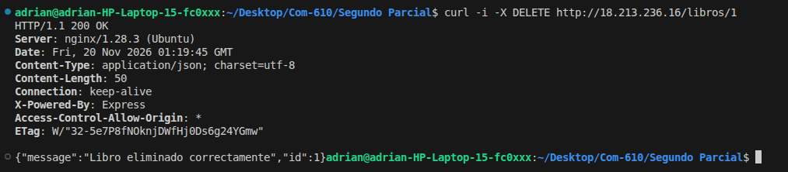

---

#### Persistencia verificada en RDS

**Captura — `SELECT * FROM libros` mostrando 10 registros en la base de datos RDS:**

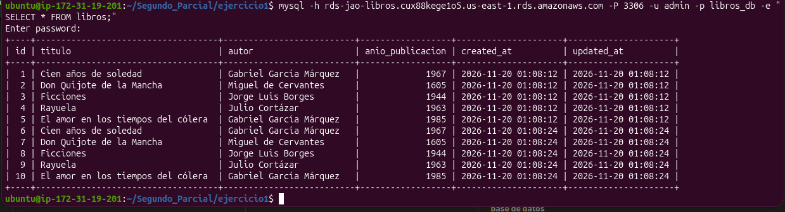

**Captura — `SELECT * FROM libros` tras operacion DELETE (registro eliminado persiste en RDS):**

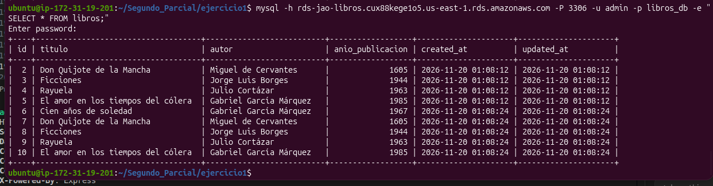

---

## Ejercicio 2 — CI/CD para la API (50 puntos)

### 2.1 Pruebas Automatizadas con Jest y Supertest

#### Estrategia de doble de prueba

Para ejecutar las pruebas sin conexion real a RDS se uso `jest.mock()` sobre el modulo `libroModel`. Esto sustituye todas las funciones del modelo por versiones simuladas (`jest.fn()`) que retornan datos controlados, permitiendo que las pruebas sean rapidas, deterministas y ejecutables en cualquier entorno sin credenciales de base de datos.

```javascript
jest.mock('../src/models/libroModel');
const libroModel = require('../src/models/libroModel');

beforeEach(() => {
  jest.clearAllMocks();
});
```

#### Casos de prueba cubiertos (34 en total)

| Caso | Metodo | Ruta | Esperado |
|---|---|---|---|
| Retorna estado ok | GET | /health | 200 con `status: "ok"` |
| Retorna lista de libros | GET | /libros | 200 con array |
| Retorna lista vacia | GET | /libros | 200 con `[]` |
| Error interno en listado | GET | /libros | 500 |
| Retorna libro por ID | GET | /libros/:id | 200 con objeto |
| ID inexistente | GET | /libros/9999 | 404 |
| ID no numerico | GET | /libros/abc | 400 |
| Error interno por ID | GET | /libros/:id | 500 |
| Crea libro valido | POST | /libros | 201 con libro creado |
| Titulo vacio | POST | /libros | 400 |
| Autor vacio | POST | /libros | 400 |
| Anio no entero | POST | /libros | 400 |
| Titulo y anio invalidos | POST | /libros | 400 |
| Campos faltantes | POST | /libros | 400 |
| Body vacio | POST | /libros | 400 |
| Error interno en creacion | POST | /libros | 500 |
| Actualiza libro | PUT | /libros/:id | 200 con libro actualizado |
| PUT ID inexistente | PUT | /libros/9999 | 404 |
| PUT titulo vacio | PUT | /libros/:id | 400 |
| PUT anio invalido | PUT | /libros/:id | 400 |
| PUT ID no numerico | PUT | /libros/abc | 400 |
| PUT sin body | PUT | /libros/:id | 400 |
| Error interno en actualizacion | PUT | /libros/:id | 500 |
| Elimina libro | DELETE | /libros/:id | 200 con mensaje |
| DELETE ID inexistente | DELETE | /libros/9999 | 404 |
| DELETE ID no numerico | DELETE | /libros/abc | 400 |
| Error interno en eliminacion | DELETE | /libros/:id | 500 |
| Ruta inexistente | GET | /ruta-invalida | 404 |

#### Resultado de `npm test` local

```
> segundo-parcial-cloud-libros-api@1.1.0 test
> jest --detectOpenHandles --forceExit

PASS ejercicio2/tests/libro.test.js
PASS tests/libro.test.js

Test Suites: 2 passed, 2 total
Tests:       34 passed, 34 total
Snapshots:   0 total
Time:        1.509 s, estimated 2 s
Ran all test suites.
```

**Captura — `npm test` local con 34 pruebas pasando:**

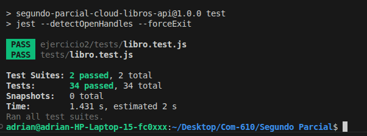

---

### 2.2 Workflow de Integracion Continua (`ci.yml`)

El workflow de CI se ejecuta automaticamente en cada `push` y `pull_request` hacia la rama `main`. Si alguna prueba falla, la ejecucion se marca como fallida y bloquea el merge.

```yaml
name: CI - Integracion Continua

on:
  push:
    branches: [main]
  pull_request:
    branches: [main]

jobs:
  test:
    name: Pruebas Automatizadas (Jest & Supertest)
    runs-on: ubuntu-latest
    steps:
      - name: 1. Checkout del codigo
        uses: actions/checkout@v4

      - name: 2. Configurar Node.js (v20)
        uses: actions/setup-node@v4
        with:
          node-version: 20
          cache: 'npm'

      - name: 3. Instalar dependencias limpias
        run: npm ci

      - name: 4. Ejecutar pruebas unitarias y de integracion con cobertura
        run: npm run test:coverage

      - name: 5. Subir reporte de cobertura como artefacto
        uses: actions/upload-artifact@v4
        if: always()
        with:
          name: coverage-report
          path: coverage/
          retention-days: 7
```

**Captura — Historial de ejecuciones: CI verde en todos los commits:**

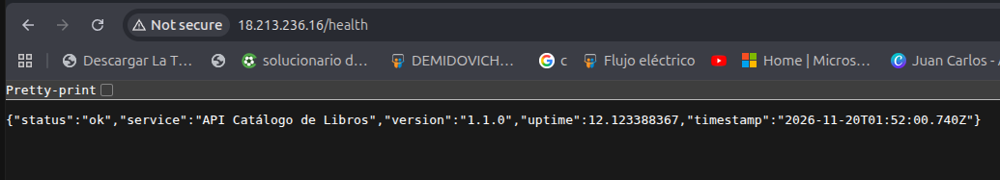

---

### 2.3 Dockerfile e Imagen Docker

El `Dockerfile` usa una construccion en dos etapas para mantener la imagen final liviana. Las credenciales de la base de datos se inyectan como variables de entorno en tiempo de ejecucion; no se incluyen en la imagen.

```dockerfile
# Etapa 1: Dependencias de produccion
FROM node:20-alpine AS builder

WORKDIR /app
COPY package*.json ./
RUN npm ci --only=production

# Etapa 2: Imagen de ejecucion
FROM node:20-alpine

WORKDIR /app

LABEL maintainer="Adrian Ovando"
LABEL description="API REST Catalogo de Libros - Segundo Parcial COM610"

COPY --from=builder /app/node_modules ./node_modules
COPY package*.json ./
COPY src/ ./src/

ENV PORT=3000 \
    NODE_ENV=production

EXPOSE 3000

# Ejecutar como usuario no privilegiado
USER node

CMD ["node", "src/server.js"]
```

Aspectos de seguridad del contenedor:
- Imagen base `node:20-alpine` (minima superficie de ataque).
- El proceso corre como usuario `node` (no root).
- Variables sensibles inyectadas en tiempo de ejecucion via `--env-file`.
- Puerto 3000 enlazado a `127.0.0.1` solamente; no expuesto a Internet.

---

### 2.4 Workflow de Despliegue Continuo (`cd.yml`)

El workflow de CD tiene tres trabajos dependientes que se ejecutan en secuencia unicamente cuando hay un `push` a `main`:

```
1. Pruebas Automatizadas  -->  2. Build y Push a GHCR  -->  3. Deploy en EC2
```

Si cualquier trabajo falla, los siguientes no se ejecutan.

#### Trabajo 1 — Pruebas Automatizadas

Ejecuta `npm ci` y `npm test` en un runner limpio de Ubuntu. Si alguna prueba falla, el pipeline se detiene.

#### Trabajo 2 — Construir y Publicar Imagen Docker en GHCR

- Autentica en GitHub Container Registry (GHCR) con `GITHUB_TOKEN`.
- Construye la imagen Docker con la accion `docker/build-push-action@v5`.
- Publica la imagen con dos etiquetas:
  - `ghcr.io/adrianovando/segundo_parcial/libros-api:<sha-del-commit>`
  - `ghcr.io/adrianovando/segundo_parcial/libros-api:latest`

#### Trabajo 3 — Desplegar en EC2 con Verificacion y Rollback

Mediante `appleboy/ssh-action@v1.0.3` se conecta por SSH a la EC2 y ejecuta:

1. Autenticacion en GHCR.
2. Guardado de referencia a la imagen anterior (para rollback).
3. Descarga de la nueva imagen con el SHA exacto del commit.
4. Detencion del contenedor anterior.
5. Inicio del nuevo contenedor enlazado a `127.0.0.1:3000:3000` usando `/home/ubuntu/.env`.
6. Espera de 6 segundos y verificacion de `/health` y `/libros`.
7. Si la verificacion falla: se muestra el log del contenedor, se elimina el nuevo y se restaura el anterior (`exit 1`).

#### Secretos configurados en el repositorio

| Secret | Contenido |
|---|---|
| EC2_HOST | IP publica de la instancia EC2 (18.213.236.16) |
| EC2_USER | Usuario SSH (ubuntu) |
| EC2_SSH_KEY | Clave privada RSA del par de claves `segundoparcial` |

**Captura — Secretos del repositorio en GitHub:**

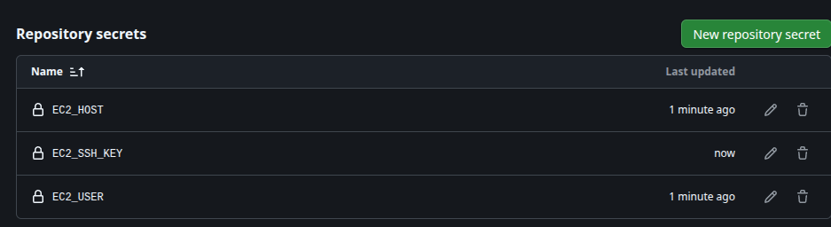

**Captura — Permisos del workflow configurados en Read and write:**

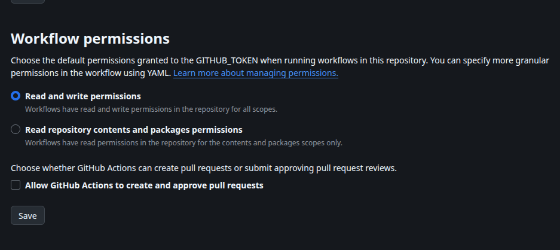

---

### 2.5 Preparacion de Docker en la Instancia EC2

Antes del primer despliegue automatico se instalo y configuro Docker en la instancia EC2:

```bash
sudo apt update && sudo apt install -y docker.io
sudo systemctl enable --now docker
sudo usermod -aG docker ubuntu
```

Se abrio temporalmente el puerto 22 a `0.0.0.0/0` en el Security Group para permitir la conexion SSH desde los runners de GitHub Actions.

**Captura — Instalacion de Docker y configuracion de grupo en EC2:**

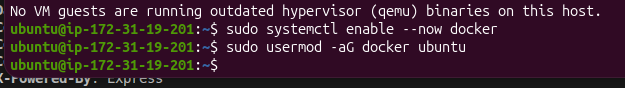

**Captura — `docker ps` sin contenedores (Docker operativo sin sudo):**

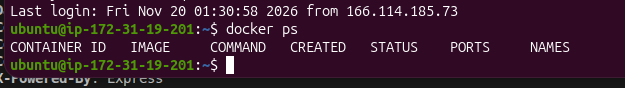

**Captura — Reglas de entrada del SG con SSH abierto para GitHub Actions:**

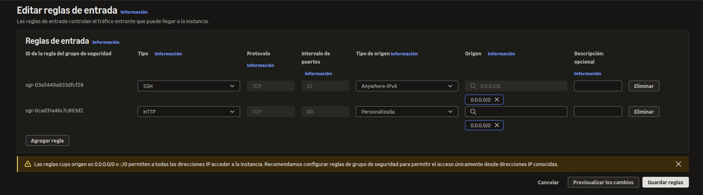

---

### 2.6 Ejecucion Exitosa del Pipeline CD

**Captura — CD run #6 exitoso: los 3 jobs en verde:**

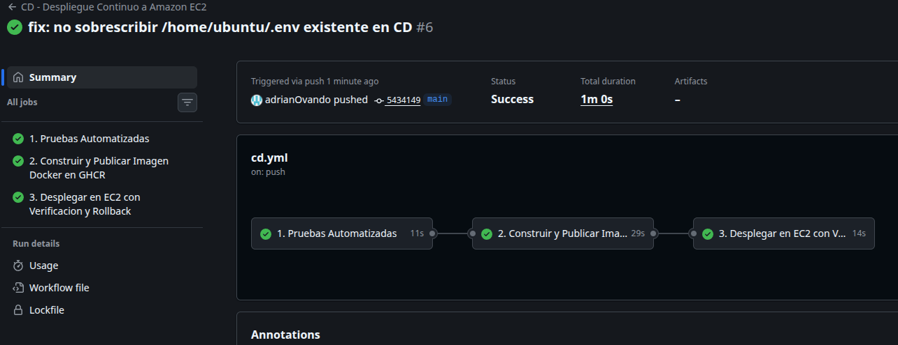

**Captura — Job 1: Pruebas Automatizadas completado:**

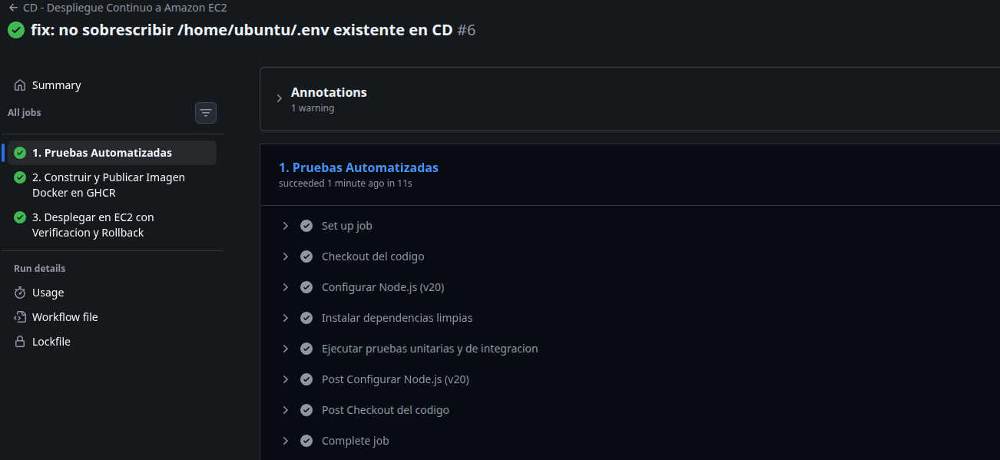

**Captura — Job 2: Build y Push de imagen a GHCR completado:**

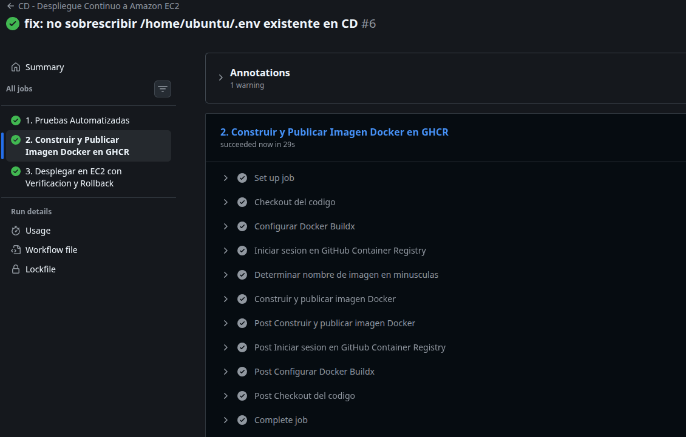

**Captura — Job 3: Deploy en EC2 con verificacion completado:**

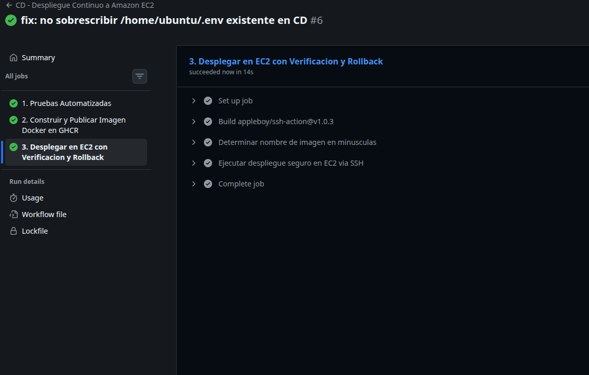

---

### 2.7 Verificacion del Despliegue con Docker

Tras el despliegue exitoso, la API quedo corriendo como contenedor Docker en la instancia EC2 con la version `1.1.0`:

```bash
curl http://18.213.236.16/health
```

```json
{
  "status": "ok",
  "service": "API Catálogo de Libros",
  "version": "1.1.0",
  "uptime": 551.5,
  "timestamp": "2026-11-20T02:01:00.121Z"
}
```

**Captura — Respuesta de `/health` en navegador confirmando version 1.1.0 con contenedor Docker:**

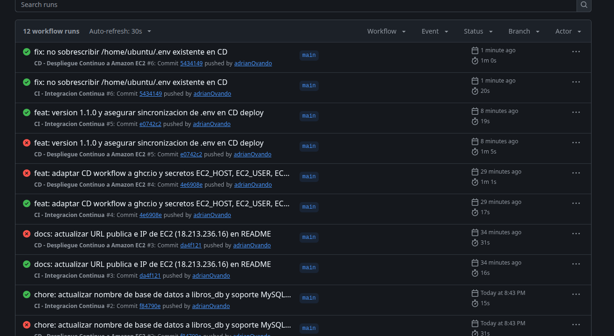

> El Ejercicio 1 (PM2) fue sustituido por el contenedor Docker del Ejercicio 2. Nginx continua operando en el puerto 80 y proxea al contenedor en `127.0.0.1:3000`. Todos los endpoints del Ejercicio 1 siguen siendo accesibles desde la misma URL publica.

---

## Recursos de AWS Utilizados

| Recurso | Identificador | Tipo | Region |
|---|---|---|---|
| EC2 | SegundoParcial | t3.micro Ubuntu 26.04 | us-east-1c |
| RDS | rds-jao-libros | MySQL 8.4 db.t4g.micro | us-east-1b |
| VPC | vpc-032109f9980f630a4 | VPC por defecto | us-east-1 |
| Security Group EC2 | ec2-jao | Puerto 22 (SSH) y 80 (HTTP) | us-east-1 |
| Security Group RDS | rds-jao | Puerto 3306 desde ec2-jao | us-east-1 |
| GHCR | ghcr.io/adrianovando/segundo_parcial/libros-api | Registro de contenedores | — |

---

## Como Verificar el Despliegue

```bash
# Verificar salud de la API
curl http://18.213.236.16/health

# Listar libros desde RDS
curl http://18.213.236.16/libros

# Verificar CI en GitHub Actions
# https://github.com/adrianOvando/Segundo_Parcial/actions/workflows/ci.yml

# Verificar CD en GitHub Actions
# https://github.com/adrianOvando/Segundo_Parcial/actions/workflows/cd.yml
```
