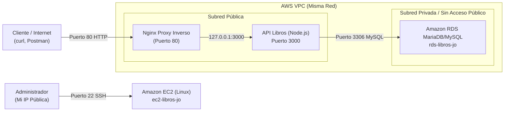

# Ejercicio 1 — Tema 4: API REST en EC2 con Base de Datos RDS (50 puntos)

**Segundo Examen Parcial — Trabajando en la Nube (COM610)**  
**Universidad San Francisco Xavier de Chuquisaca**  
**Docente:** Ing. Marcelo Quispe Ortega  
**Estudiante:** Jesús Adrián Ovando  

---

## 1. Descripción del Ejercicio

Este ejercicio implementa una **API REST pública para la gestión de un catálogo de libros** desarrollada con **Node.js y Express**, desplegada en una instancia **Amazon EC2 (Ubuntu/Amazon Linux)** y conectada a una base de datos gestionada **Amazon RDS (MySQL / MariaDB)** con acceso público deshabilitado. La API se publica a Internet a través de **Nginx configurado como proxy inverso en el puerto 80**.

---

## 2. Arquitectura de Red y Seguridad en AWS



### Configuración de Grupos de Seguridad (Security Groups)

| Recurso AWS | Nombre sugerido | Tipo | Protocolo | Puerto | Origen permitido | Propósito |
|:---|:---|:---|:---|:---|:---|:---|
| **EC2** | `ec2-libros-sg` | Inbound | SSH | 22 | `Mi_IP_Publica/32` | Acceso seguro a consola por terminal. |
| **EC2** | `ec2-libros-sg` | Inbound | HTTP | 80 | `0.0.0.0/0` (Cualquiera) | Tráfico web público a través del proxy Nginx. |
| **RDS** | `rds-libros-sg` | Inbound | MySQL/Aurora | 3306 | `sg-xxxxxx` (`ec2-libros-sg`) | Conexión privada exclusiva desde la instancia EC2. |

> **IMPORTANTE:**
> - El puerto 3000 (Node.js) **NO** debe abrirse en el Grupo de Seguridad de EC2 hacia Internet.
> - El puerto 3306 de RDS **NO** tiene acceso público (`Acceso público: No`) y solo acepta tráfico proveniente del Grupo de Seguridad de EC2.

---

## 3. Modelo de Datos y Script SQL (`db.sql`)

La tabla `libros` se define en el archivo [`db.sql`](./db.sql):

```sql
CREATE DATABASE IF NOT EXISTS biblioteca CHARACTER SET utf8mb4 COLLATE utf8mb4_unicode_ci;
USE biblioteca;

CREATE TABLE IF NOT EXISTS libros (
  id INT AUTO_INCREMENT PRIMARY KEY,
  titulo VARCHAR(255) NOT NULL,
  autor VARCHAR(255) NOT NULL,
  anio_publicacion INT NOT NULL,
  created_at TIMESTAMP DEFAULT CURRENT_TIMESTAMP,
  updated_at TIMESTAMP DEFAULT CURRENT_TIMESTAMP ON UPDATE CURRENT_TIMESTAMP
) ENGINE=InnoDB DEFAULT CHARSET=utf8mb4 COLLATE=utf8mb4_unicode_ci;
```

### Cargar el script en RDS desde EC2
Una vez conectado por SSH a EC2:
```bash
mysql -h <ENDPOINT_RDS> -P 3306 -u admin -p < db.sql
```

---

## 4. Endpoints de la API

| Método | Ruta | Código HTTP | Descripción |
|:---|:---|:---:|:---|
| `GET` | `/health` | `200 OK` | Devuelve JSON con el estado activo del servicio y tiempo de actividad. |
| `GET` | `/libros` | `200 OK` | Devuelve la lista completa de libros almacenados en RDS. |
| `GET` | `/libros/:id` | `200` / `404` | Devuelve un libro por su ID; responde `404` si no existe. |
| `POST` | `/libros` | `201 Created` | Crea un libro válido con `titulo`, `autor` y `anio_publicacion`. Responde `400` ante datos inválidos. |
| `PUT` | `/libros/:id` | `200` / `404` | Actualiza un libro existente. Valida campos (`400`) y existencia (`404`). |
| `DELETE` | `/libros/:id` | `200` / `404` | Elimina un libro existente por ID; responde `404` si no existe. |

---

## 5. Guía de Despliegue en EC2

### 1. Conectarse a EC2 por SSH
```bash
ssh -i "tu-llave.pem" ubuntu@<EC2_PUBLIC_IP>
```

### 2. Instalar Node.js 20 LTS, Nginx y Git
```bash
sudo apt update && sudo apt upgrade -y
curl -fsSL https://deb.nodesource.com/setup_20.x | sudo -E bash -
sudo apt install -y nodejs nginx git mysql-client
sudo npm install -g pm2
```

### 3. Clonar el repositorio y configurar variables de entorno
```bash
git clone https://github.com/adrianOvando/Segundo_Parcial.git
cd Segundo_Parcial/ejercicio1
npm install --only=production
cp .env.example .env
nano .env
```
Configura las credenciales reales de tu RDS en `.env`:
```env
PORT=3000
DB_HOST=rds-libros-db.xxxxxx.us-east-2.rds.amazonaws.com
DB_PORT=3306
DB_USER=admin
DB_PASSWORD=TuPasswordSeguro123!
DB_NAME=biblioteca
NODE_ENV=production
```

### 4. Iniciar la API con PM2
```bash
pm2 start src/server.js --name libros-api
pm2 save
pm2 startup
```

### 5. Configurar Nginx como Proxy Inverso en Puerto 80
Copia el archivo `nginx.conf`:
```bash
sudo cp nginx.conf /etc/nginx/sites-available/default
sudo nginx -t
sudo systemctl restart nginx
```

---

## 6. Verificación de Operaciones con `curl`

Reemplaza `<EC2_PUBLIC_IP>` con la IP pública de tu instancia:

```bash
# 1. Healthcheck
curl -i http://<EC2_PUBLIC_IP>/health

# 2. Consultar catálogo
curl -i http://<EC2_PUBLIC_IP>/libros

# 3. Crear nuevo libro (POST 201)
curl -i -X POST http://<EC2_PUBLIC_IP>/libros \
  -H "Content-Type: application/json" \
  -d '{"titulo": "El Aleph", "autor": "Jorge Luis Borges", "anio_publicacion": 1949}'

# 4. Validar rechazo de datos inválidos (POST 400)
curl -i -X POST http://<EC2_PUBLIC_IP>/libros \
  -H "Content-Type: application/json" \
  -d '{"titulo": "", "autor": "Autor", "anio_publicacion": "dos mil"}'

# 5. Consultar libro por ID (GET 200)
curl -i http://<EC2_PUBLIC_IP>/libros/1

# 6. Consultar libro inexistente (GET 404)
curl -i http://<EC2_PUBLIC_IP>/libros/99999

# 7. Actualizar libro (PUT 200)
curl -i -X PUT http://<EC2_PUBLIC_IP>/libros/1 \
  -H "Content-Type: application/json" \
  -d '{"titulo": "Cien años de soledad (Edición Ilustrada)", "autor": "Gabriel García Márquez", "anio_publicacion": 1967}'

# 8. Eliminar libro (DELETE 200)
curl -i -X DELETE http://<EC2_PUBLIC_IP>/libros/1
```
